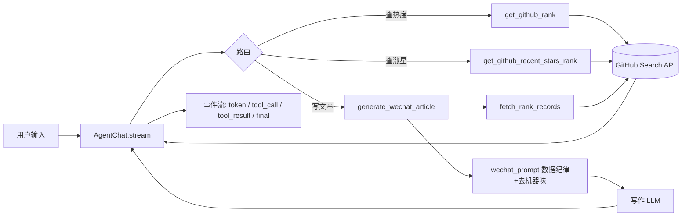

<div align="center">

# githot · GitHub 热门仓库助手

**基于 LangChain / LangGraph 的 GitHub 热榜 Agent：流式输出、多轮记忆，并能把榜单直接写成一篇可发布的公众号文章。**

A GitHub trending-repos agent built on LangChain / LangGraph — streaming output, multi-turn memory, and one-click ranking-to-article generation.

`Python 3.11+` · `LangChain` · `LangGraph` · `GitHub Search API`

</div>

---

## 简介 / Overview

`githot` 把「查 GitHub 新晋热门仓库」和「把这些仓库写成内容」两件事封装进一个可对话的 Agent：

- **查榜单**：调用 GitHub Search API，返回最近 N 天内新建的高星仓库；支持两种口径——**星标总量榜**和**平均每天涨星速度榜**。
- **多轮对话**：同一会话自动沿用上一轮的语言 / 天数 / 星数条件，你只需说「换成涨星最快的」，不用重复交代背景。
- **流式输出**：模型逐字吐字，工具调用 / 结果全程可观测（终端逐字打印，或拿事件流自己渲染）。
- **生成公众号文章**：把榜单数据交给写作模型，产出一篇可直接发布的 Markdown 推文——数据全程程序化传递，**不让模型手抄排行榜**，杜绝编造星数与功能。

> `githot` wraps "finding trending new GitHub repos" and "turning them into content" into a single conversational agent: query leaderboards via the GitHub Search API, keep multi-turn context, stream tokens token-by-token, and generate a publish-ready WeChat article from the ranking data — with the data passed programmatically so the model never "hand-copies" (and fabricates) it.

---

## 功能特性 / Features

| | 能力 / Capability | 说明 / Detail |
| --- | --- | --- |
| 🌊 | **流式输出 Streaming** | `stream_mode=["messages","values"]` 双通道，逐字打印 + 兜底完整答案 |
| 🧠 | **多轮记忆 Multi-turn** | 靠 LangGraph `checkpointer` + `thread_id` 隔离会话，无需手动拼 messages |
| 🔧 | **工具路由 Tool routing** | 提示词把「什么话 → 调哪个工具、填什么参数」写死，抽参准确率高 |
| 📊 | **两种榜单 Two boards** | 星标总量榜（绝对热度）/ 涨星速度榜（`stars ÷ 已存在天数`） |
| ✍️ | **文章生成 Article** | 取数 → 组装 → 写作三层管线，4 种风格，含【数据纪律】+【去机器味】 |
| 🛡️ | **参数容错 Robust args** | 模型传 `days_age="5"`、`min_stars="None"` 也能兜底，不浪费一次重试 |
| 🔌 | **可插拔持久化 Pluggable** | `InMemorySaver` → `SqliteSaver` 一处替换，其余代码不动 |

---

## 架构 / Architecture

```
githot/
├── __init__.py            # 包入口：统一导出 AgentChat / AgentEvent / 展示工具
├── __main__.py            # python -m githot → 直接开一个终端多轮会话
├── requirements.txt       # 依赖清单
├── agent/
│   ├── agent_chat.py      # Agent 图 + AgentChat（流式 / 多轮 / CLI REPL）
│   ├── llm_model.py       # ChatOpenAI 工厂：读 .env，lru_cache 复用实例
│   └── utils.py           # 展示层小工具：message_text / preview / print_event
├── prompt/
│   ├── github_prompt.py   # 查询与工具路由的 system prompt
│   └── wechat_prompt.py   # 写作 prompt + 风格模板 + 版式种子 + 禁词表
└── tools/
    ├── github_tools.py    # GitHub Search API 取数 + 两个 @tool（榜单）
    └── wechat_tools.py    # 榜单 → 公众号文章（取数 / 组装 / 生成 三层）
```

**数据流 / Data flow**



> 关键点：`generate_wechat_article` **自己调用取数函数**，而不是让对话模型把刚查到的榜单复述一遍——模型转述长 JSON 会漏字段、改星数、把 `description` 意译成"事实"，正好踩中写作 prompt 里【数据纪律】要防的那条。数据全程只经过一次程序化 `json.dumps`。

---

## 快速开始 / Quick Start

### 1. 安装 / Install

```bash
git clone https://github.com/<your-username>/githot.git
cd githot
python -m venv .venv && source .venv/bin/activate   # 建议虚拟环境
pip install -r requirements.txt
```

> 需要 **Python 3.11+**（`requirements.txt` 中的 `numpy` 版本要求）。代码使用 `str | None` 等语法，最低不低于 3.10。

### 2. 配置模型 / Configure the model

项目通过 [python-dotenv](https://pypi.org/project/python-dotenv/) 读取环境变量，兼容任何 **OpenAI 协议**的接口（OpenAI 官方、DashScope/通义千问、OneAPI、本地 vLLM 等）。在项目根目录新建 `.env`：

```bash
# .env
API_KEY=sk-xxx...your-key-here
BASE_URL=https://dashscope.aliyuncs.com/compatible-mode/v1
MODEL=qwen-plus
```

| 变量 | 含义 | 示例 |
| --- | --- | --- |
| `API_KEY` | 接口密钥 | `sk-...` |
| `BASE_URL` | OpenAI 兼容 base_url | `https://api.openai.com/v1` |
| `MODEL` | 模型名 | `qwen-plus` / `gpt-4o-mini` |

> ⚠️ `.env` 含密钥，**不要提交**。请先在仓库根目录放一个 `.gitignore`（见下方「安全 / Security」）。
> 修改 `.env` 后想让配置热生效，调用 `agent.llm_model.reset_llm_cache()` 清掉 `lru_cache`。

### 3. 运行 / Run

```bash
python -m githot                        # 推荐：在项目根目录运行
# 或
python githot/agent/agent_chat.py       # 直接跑文件也可以
```

进入终端多轮会话，逐字流式输出：

```
====================================================
GitHub 热门仓库助手（流式输出 + 多轮记忆）
输入"退出"结束会话；输入"清除"清空上下文；输入"历史"查看消息数
当前会话 thread_id：xxxxxxxx-....

你：最近7天 Python 高星新仓库，前3
助手：第1名｜xxx ...（逐字流式）
你：换成涨星速度最快的       # 多轮：自动沿用"Python / 7天"
你：把这几个写成一篇公众号文章，800字，轻松点   # 触发 generate_wechat_article
```

会话内命令：**退出** `退出/exit/quit/:q` · **清空记忆** `清除/清空/clear/reset` · **查看消息数** `历史/history`

---

## 用法 / Usage

### 命令行多轮对话 / CLI

见上方「运行」。一个 `AgentChat()` 实例 = 一个会话（一个 `thread_id`）。

### 代码里调用 / Python API

```python
from githot import AgentChat

chat = AgentChat()                          # 一个会话 = 一个 thread_id
chat.send("最近7天 Python 高星新仓库，前3")   # 边流式打印边返回完整答案
chat.send("换成涨星速度最快的")               # 多轮：沿用上一轮的语言/天数条件
chat.ask("再看看 Rust 的")                   # 静默版：只返回文本，不打印
chat.history()                              # 当前会话消息列表（含工具调用记录）
chat.clear()                                # 重开一局（换新 thread_id，清空记忆）
```

### 只要事件流，自己渲染 / Event stream

`send()` / `ask()` 底层都是 `stream()`。Web、SSE、富文本终端等基于它封装，不必改 `agent_chat.py`：

```python
for event in chat.stream("最近一个月 Go 高星新仓库"):
    ...  # event.kind: token / thinking / tool_call / tool_result / final
```

| `kind` | 含义 | `data` |
| --- | --- | --- |
| `token` | 模型正文增量（逐字） | 文本片段 |
| `thinking` | 模型思考过程增量（Qwen `enable_thinking`） | 思考文本 |
| `tool_call` | 模型请求调用工具 | 参数 dict（`name`=工具名） |
| `tool_result` | 工具执行完毕 | 截断后的结果预览 |
| `final` | 本轮最终答案 | 完整答案文本 |

- 想要思考过程：`AgentChat(show_thinking=True)`。
- 展示层小工具可单独复用（不必经过 `AgentChat`）：

```python
from githot.agent.utils import message_text, preview, print_event

message_text(msg)                 # 消息/裸 content → 纯文本（自动跳过 thinking 等内容块）
preview(tool_output, limit=200)   # 工具返回值压成一行并截断，防刷屏
print_event(event)                # 终端渲染；做 Web 时换成自己的渲染函数即可
```

### 公众号文章生成 / Article generation

数据抓取 → 提示词构建 → 大模型写作，三段式管线。可脱离对话直接调用：

```python
from githot.tools.wechat_tools import generate_article, fetch_rank_records, stream_article

# 一步到位：取数 + 写整篇（阻塞）
meta, records, article, error = generate_article(
    board="rising", language="Go", style="轻松段子", word_count=800)
print(article)

# 逐字流式（先取数，再把正文一段段吐出来）
meta, records, error = fetch_rank_records("hot", 7, "Python", None, 5)
for text in stream_article(records, meta, style="科技种草", word_count=800):
    print(text, end="", flush=True)
```

对话里也能直接触发——说一句「把最近7天 Python 涨星最快的仓库写成一篇公众号文章，800字，轻松点」，Agent 调用 `generate_wechat_article` 工具后，把生成的 Markdown 原样输出。

---

## 工具参考 / Tools Reference

Agent 挂载三个工具（`agent/agent_chat.py` 里的 `tools` 列表）：

| 工具 | 作用 | 关键参数（默认值） |
| --- | --- | --- |
| `get_github_rank` | **星标总量榜**：时间窗内新建、星标总数最高的仓库 | `days_age`(7) · `language`(None) · `min_stars`(50) · `rank`(7, ≤30) |
| `get_github_recent_stars_rank` | **涨星速度榜**：按 `新增星标 ÷ 已存在天数` 降序，找"这几天涨星最猛"的新库 | `days_age`(7) · `language`(None) · `min_stars`(10) · `rank`(7, ≤30) |
| `generate_wechat_article` | 榜单数据 → 一篇可发布的公众号文章（Markdown 全文，**自带取数**） | `board`(hot) · `days_age`(7) · `language` · `min_stars` · `rank`(5) · `style`(科技种草) · `word_count` |

返回记录字段：`name` · `path` · `description` · `stars` · `author` · `rank` · `details`；涨星榜额外含 `stars_per_day` · `created_at`；文章管线取数时再带 `topics` / `forks` / `open_issues` / `license` / `pushed_at` / `homepage`（事实越具体，句子越有内容，越不需要靠套话凑字数）。

> GitHub Search API 单页上限 30，`rank` 一律钳制在 `[1, 30]`；`403` 会被翻译成"请求过于频繁，请稍后再试"。

---

## 写作风格 / Article Styles

`prompt/wechat_prompt.py` 里的 `ARTICLE_STYLES`（`list_article_styles()` 可查）：

| 风格 | 语气 / 排版 |
| --- | --- |
| **科技种草**（默认） | 像真在用工具的开发者，克制、信息密度高；必须有一句明确取舍判断 |
| **热点资讯** | 短讯体，先事实后一句背景，不做主观评价；不用小标题，500–700 字 |
| **轻松段子** | 口语有梗，小标题 `## 仓库名｜一句吐槽`（吐槽基于 description，不编功能） |
| **深度解读** | 分析型，中文序号小标题，允许按主题分组；分析显式标成"我的判断" |

**两道核心纪律：**

- **【数据纪律】**：仓库名、星数、链接、描述**只能来自数据区**，禁止根据仓库名/记忆补写功能、场景、"亲测体验"。加工的是措辞，不是事实。
- **【去机器味】**：禁用"值得注意的是 / 赋能 / 总的来说…"等套话清单；正文不得出现 `stars`/`topics` 等 JSON 键名；句长必须不齐、各节篇幅必须不等；每次随机抽取一套"版式种子"（小节顺序、开头、结尾、链接写法），避免同风格连生成两篇结构 100% 同构。

---

## 持久化记忆 / Persistent memory（可选）

默认用进程内 `InMemorySaver`：同一 `thread_id` 的记忆在**进程存活期间**保留，进程退出即清空。要跨进程持久化，把 `agent/agent_chat.py` 里的检查点换掉即可，其余代码不动：

```bash
pip install langgraph-checkpoint-sqlite
```

```python
# agent/agent_chat.py 内
from langgraph.checkpoint.sqlite import SqliteSaver
checkpointer = SqliteSaver.from_conn_string("githot_checkpoints.sqlite")
```

---

## 设计要点 / Design Notes

几处值得说明的取舍，都写在源码注释里：

1. **多轮记忆靠 checkpointer，不靠自己拼 messages。** 有 `checkpointer` 后每轮只传最新一条 `HumanMessage`，历史由框架按 `thread_id` 自动拼接。
2. **流式用双通道。** `"messages"` 拿逐字增量做即时打印，`"values"` 拿完整状态取工具调用信息、最终答案，以及"模型一个字都没流出来（整轮只有工具调用）"时的兜底。只过滤 `langgraph_node == "model"` 的增量给用户，避免打印工具节点的杂项。
3. **包内 import 统一走 `githot.xxx`。** 若混用 `agent.xxx` 与 `githot.agent.xxx`，`agent_chat` 会被加载两遍 → 两个 `checkpointer` → 不同入口之间记忆对不上。文件顶部做了 `sys.path` 兜底，保证四种跑法都可用。
4. **提示词与工具逐字对齐。** 工具名必须与 `tools/*.py` 里 `@tool` 函数名一致，`github_prompt.py` 头部注释记录了旧版踩过的坑（角色失实、复制来的死规则、拼错的工具名）。
5. **写作与查询分两个 prompt。** 混在一起会让模型同时被要求"如实罗列"和"写得有感染力"，于是开始给仓库编造用途。

---

## 环境要求 / Requirements

- Python 3.11+
- 一个 OpenAI 协议兼容的大模型接口（`API_KEY` / `BASE_URL` / `MODEL`）
- 能访问 `https://api.github.com`（未配置 GitHub token，走匿名限额；高频使用请自行加 token 或控制频率）

主要依赖见 `requirements.txt`：`langchain` · `langchain-openai` · `langgraph`（随 `langchain` 安装）· `python-dotenv` · `requests` · `rich`。

---

## 安全 / Security

仓库根目录建议放置 `.gitignore`，至少屏蔽密钥与缓存：

```gitignore
.env
__pycache__/
*.pyc
.venv/
*.sqlite
```

- **切勿提交 `.env`**（内含 `API_KEY`）。
- 对外提供 HTTP 接口前，请自行加鉴权与 CORS 白名单（本仓库当前只包含 CLI 与可嵌入的 Python API，未内置 Web 服务）。

---

## 路线图 / Roadmap

- [ ] SSE / HTTP 接口封装（把 `AgentChat.stream()` 事件流对接 Web）
- [ ] 持久化 checkpointer 作为可选项内置
- [ ] GitHub token 支持，提升 API 限额
- [ ] 更多写作风格与自定义版式种子

> 欢迎 Issue 与 PR。

---

## 许可 / License

选定的开源许可证尚未添加。发布前请在仓库根目录放置 `LICENSE`（如 MIT），并在此处补充说明。
No license file has been added yet — please add a `LICENSE` (e.g. MIT) at the repo root before publishing.
